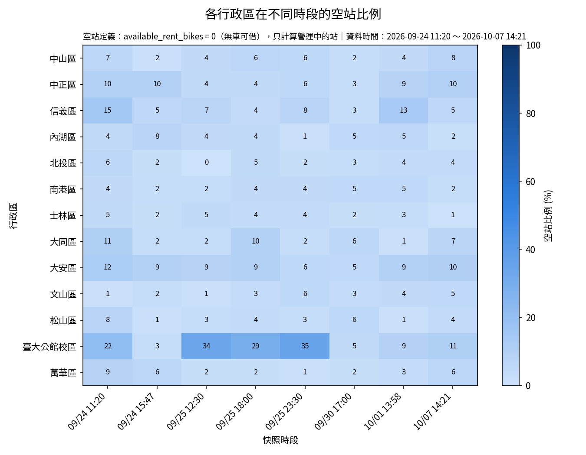

# HW3 | YouBike 快照的 Pandas 分析

| **項目** | **內容** |
| --- | --- |
| 學號 ／ 姓名 | S1254059 / 吳佳泰 |
| 週次 | 第三週 |
| 使用工具 | Claude Code CLI |
| 模型與權限模式 | manual |
| 成果連結 | [Google Colab](https://drive.google.com/file/d/11uiB-HBoPPAoeiNMVgcvbTglzFyG4Msu/view?usp=sharing)、[GitHub](https://github.com/taitaiwu/python/blob/main/GIS_Programming/notebooks/02_youbike_json.ipynb)、[Notion](https://app.notion.com/p/HW3-YouBike-Pandas-3ec7553c0e89806fac98e44ff314d1f9?v=78f7553c0e89823db22008fb904e62d6&source=copy_link)|
| 花費時間 | 約  5 小時 |

# 1. Before AI

**本週引導題的回答：**

1. **你預期平日早上通勤時段，哪些區的站最容易沒車？哪些區最容易滿站？為什麼？**
    
    > 通常是捷運站附近最容易沒車，學校和商業區較容易滿站，因為人們早上通勤在捷運站下車之後可能還有一段通勤距離，因此需要 YouBike
    
2. **「空站」應該怎麼定義？請先寫**你自己的定義**，再問 AI。**
    
    > 我上課前原本以為空站就是沒有可借車輛的站點，上課實際示範的不是三種「空站」的定義本身，而是三個會改變算出來的空站比例的決策維度：
       1. 空站門檻——可借車數要等於 0 才算，還是 ≤ 2 也算？
       2. 分母——全部站都算，還是只算營運中的站？
       3.  代表值——用平均數還是中位數？我原本以為空站只有一種算法（可借 = 0）
    
    沒想過門檻、分母、代表值這三個維度都會讓同一份資料算出不同的比例，這三點都是上課才知道的。
    
3. **我不知道的是……（至少寫 2 點）**
    > * 我不是台北人，對於臺北不熟，所以對於每一區的人流其實沒有概念
    > * 空站的實際定義該怎麼算才精確

---

# 2. Ping-Pong Log

| 輪次 | 我的提問 | AI 回應重點 | 我的觀察 |
| --- | --- | --- | --- |
| 1 | 你對空站的定義是什麼 | 空站 = 營運中（`act == True）且 available_rent_bikes == 0（站內沒有車可借）的站。 | 想比較不同定義的結果 |
| 2 | 用兩種定義（可借 = 0 與 ≤ 2）各算一次，比較結論有沒有改變 | 用純 Python 依同一套邏輯跑過真實的 8 份快照資料驗證，證實換一個定義真的會改變結論。 | 想知道到底相差多少 |
| 3 | 包含與不包含暫停營運的站，結果差多少？哪幾區差最多？為什麼？ | 在「9. 包含 vs 不包含暫停營運站」新增結果 | 萬華區受影響最大（平均差異 +4.7 個百分點） |

---

# 3. 決策表

| 編號 | AI 的建議 | 採納／拒絕／修改 | 我的理由 | 我怎麼驗證（具體動作） |
| --- | --- | --- | --- | --- |
| 1 | ★空站定義用 available_rent_bikes == 0（嚴格），且只計算營運中站當分母 | 採納定義本身，但追加用 threshold=2 的寬鬆定義做敏感度測試 | available_rent_bikes 才是實際「有沒有車可借」，Quantity 只是站點容量不是當下狀態；但只驗證一種定義不夠穩健，所以要求比較兩種定義看結論會不會變 | 把 calc_ratio 加上 threshold 參數，分別用 0 與 2 各算一次空站比例並轉成寬表相減，對 8 份快照各取空站比例最高的前三個行政區比較集合是否相同，結果 8 份裡有 6 份前三名不同，證實換定義真的會改變結論 |
| 2 | 計算空站／滿站比例時分母只用營運中（act=True）站，暫停營運站直接排除 | 採納 | 暫停營運站的可借／可還車數字是殘留值不是即時狀態，核對過有些暫停站的 available_rent_bikes 或 available_return_bikes 不是 0，混進去會讓比例失真 | 把 calc_ratio 加上 include_inactive 參數，分別算含與不含暫停站兩個版本的空站比例寬表並逐格相減，再按行政區排序平均差異，結果萬華區差最多（平均 +4.7 個百分點），因為它的暫停站佔比 6.0% 是 13 區最高，大同區、南港區、臺大公館校區這 8 份快照都沒有暫停站紀錄所以差異是 0 |
| 3 | 用檔名（youbike_YYYYMMDD_HHMM.json）解析出的時間當 snapshot_time，不是用 mday 或 infoTime 等逐站欄位 | 採納，但追加驗證間隔與星期是否符合設計 | 同一份快照裡每站的 mday／infoTime 可能各差幾秒，用檔名當整批快照統一的時間點比較一致、好分組 | 把 8 個檔名時間轉成 datetime 後算星期與間隔，結果是週四、週五、週三、週四、週三交錯出現，間隔從 4.5 小時到 144.4 小時都有，不是等距設計，代表這些快照是分次隨意補抓而非刻意設計的早上通勤採樣，之後要講某個時段的結論要特別小心 |
| 4 | 一直把臺大公館校區當成跟其他 12 個行政區平等的分類一起算，沒有主動提出要不要保留 | 修改，先保留現狀但標記為待決 | 它不是真正的行政區，站數明顯偏少，擔心樣本小造成比例結果不穩定、容易佔上最高的位置但沒有代表性 | 數了一份快照裡每個分類的站數，臺大公館校區只有 65 站，是 13 個分類裡最少的（第二少的大同區有 84 站）；對照前面兩種定義的前三名清單，臺大公館校區在 8 份快照中有 6 份都出現在前三名，顯示它的排名可能只是小樣本波動，留到 W6 空間連接驗證再決定要保留、合併還是排除 |

---

# 4. 最終產出與個人結論

* 最終產出
    
    
    
* 個人結論
    > * 從圖表（熱力圖）看到的模式：臺大公館校區在 8 份快照裡有 5 份的空站比例最高（嚴格定義下），其中 9/25 23:30 那份甚至到 35.4%，換成寬鬆定義（可借 ≤ 2）更衝到 72.3%；大安區、中正區、信義區也常偏高；南港區、大同區、文山區則幾乎每個時段都偏低。單看熱力圖，很容易直接下「臺大公館校區最容易沒車」的結論。
    > * 這個觀察可能不可靠的地方：
          - 8 份快照的時間分別是 9/24 11:20、9/24 15:47、9/25 12:30、9/25 18:00、9/25 23:30、9/30 17:00、10/1 13:58、10/7 14:21——沒有一份落在早上 7:30-9:00 的通勤尖峰，熱力圖呈現的其實是「中午到深夜」的狀態，沒有資料能直接驗證我在 Before AI 最初猜的「早上通勤時段最容易沒車」。
          - 臺大公館校區只有 65-93 站，是 13 個分類裡站數最少的，樣本小容易被少數幾站的狀態波動拉高比例，排名可能只是小樣本噪音，不代表它真的「最常沒車」。
          - 每個時段只抓了 1 次快照，看到的差異有可能只是當天特定事件（例如某天特別多人騎出門、系統剛補完車），不能代表這個時段真正的常態。
    > * 協作過程的反思：整個過程中，AI 大多先給出一個預設做法（例如用 act 排除暫停站、用檔名當快照時間），我沒有照單全收，而是每次都追問「這樣做會差多少、為什麼」，要求它用真實資料或手造的小測試數字證明，而不是憑直覺判斷；中途也遇過 Colab 同步覆蓋掉剛寫好的程式碼，得先重新核對磁碟上的實際內容才能繼續，這也提醒我不能完全信任「看起來存檔成功」的訊息，還是要自己再檢查一次。
    

---

# 5. 附件

* [對話紀錄：03_youbike_pandas.ipynb 建立與分析](../conversation/03_youbike_pandas_對話紀錄.md)
* [03_youbike_snapshots_clean.csv](../data/processed/03_youbike_snapshots_clean.csv)