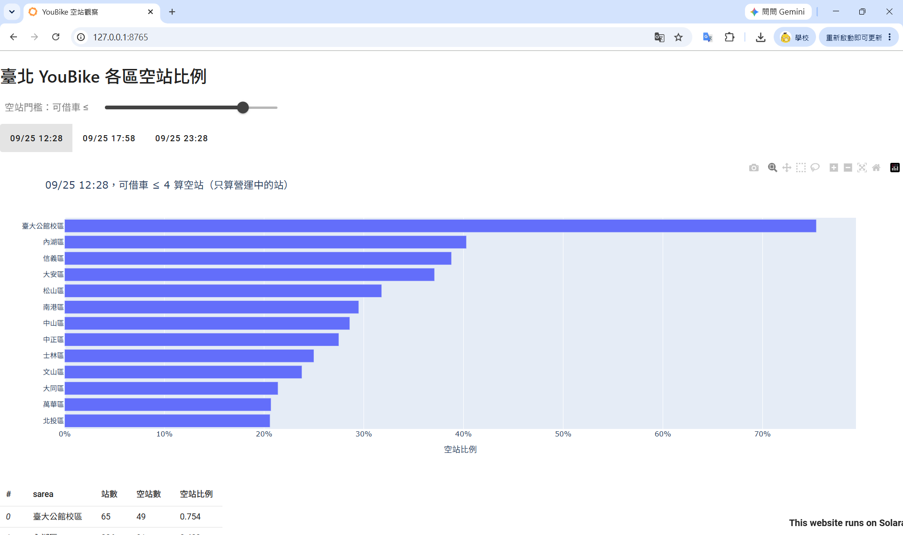

# HW4｜建立 repo 與第一個 Solara 頁面

| **項目** | **內容** |
| --- | --- |
| 學號 ／ 姓名 | S1254059 / 吳佳泰 |
| 週次 | 第四週 |
| 使用工具 | Claude Code CLI |
| 模型與權限模式 | manual |
| 成果連結 | [GitHub](https://github.com/taitaiwu/gisprog-app)、[Notion](https://app.notion.com/p/HW4-repo-Solara-3f37553c0e8980af8646f76b0543ccb5?v=78f7553c0e89823db22008fb904e62d6&source=copy_link) |
| 花費時間 | 約 5 小時 |

# 1. Before AI

**本週引導題的回答：**

1. **`commit` 和 `push` 有什麼不同？關掉 Codespace 後，沒有 commit 的修改還在嗎？**
    
    > `commit` 是將程式碼的修改儲存在本地端，而 `push` 則會把程式碼推上遠端倉庫(repo)。關掉 Codespace 後，沒有 `commit` 的修改會消失。這些都是之前就知道的。
    
2. **看 template 裡的 `app.py`，猜猜看：要加一個「選擇行政區」的下拉選單，應該改哪幾行？**
    
    > 可以在第 42 行(空站門檻拉桿)之後加上 `solara.Select` 的物件。
    
3. **我不知道的是……（至少寫 2 點）**
    > * `solara` 的套件詳細用法
    > * `solara` 的套件實際應用

---

# 2. Ping-Pong Log

| 輪次 | 我的提問 | AI 回應重點 | 我的觀察 |
| --- | --- | --- | --- |
| 1 | 我如果要加上一個行政區的選單會需要修改那一些地方 | 列出 `app.py` 要改的 4 個地方：選項清單、 reactive 變數、 `Select`元件、篩選資料。指出關鍵問題是「選了單一區後，圖要顯示什麼」，並給出 A/B/C 三種做法。最後提醒：選項裡會出現「臺大公館校區」，它在 `sarea` 欄位裡，但不是行政區 | 他最後提到台大公館校區的問題 |
| 2 | 你剛剛說的臺大公館校區的問題是什麼 | 先檢查資料再回答： `sarea` 有 13 種值，但臺北市只有 12 區；這 65 站都是 `500119` 開頭，英文名是 `NTU Dist`。說明影響：圖上多一根不是行政區的長條，而且剛好排第 1；大安區、中正區會少算。最後提出 A 保留加註、B 排除、C 依經緯度歸回所在行政區三種做法，並分析各自的優缺點 | AI 給了三種選項，而我偏好 C 選項 |
| 3 | 那我選 C | 因為會改到多個檔案，依照 `CLAUDE.md` 規範進入 Plan 模式，先問兩件事：界線資料從哪裡來、要處理哪些站。計畫中列出會改的檔案： `app.py`、 `requirements.txt`， `README.md`則要我另外同意。也說明要新增 `geopandas 的理由`。 `data/` 是唯讀的，所以界線檔要由我自己下載放進去 | AI 先說明計畫和會動到哪些檔案，經我確認後才動手 |
| 4 | 安裝好了，請執行後續步驟 | 先檢查目前狀態：發現我放進去的是界線檔，但 `geopandas` 其實還沒裝。先說明安裝指令會做什麼再執行，用 `pip index versions` 查到穩定版後，在 `requirements.txt` 寫入 `geopandas==1.2.0`。也以唯讀方式檢查界線檔的欄位和座標系統，確認有 12 個行政區。結果：65 站全部對到行政區，大安區 59 站、中正區 6 站，抽查也符合預期。另外提醒 shp 檔有 18 MB，部署到 HuggingFace 時會遇到容量限制 | 工作已完成，請 AI 幫我把說明補到 `README.md` |
| 5 | 好，幫我更新 README | 更新資料表（YouBike 資料、行政區界線、資料處理說明）和授權段落。沒有動「App 用途」，因為作業要求用我自己的話寫 | 本輪 Ping-Pong 結束 |

---

# 3. 決策表

| 編號 | AI 的建議 | 採納／拒絕／修改 | 我的理由 | 我怎麼驗證（具體動作） |
| --- | --- | --- | --- | --- |
| 1 | 為了修正手機版排版，AI 自行加了 圖表重新量寬度 元件（ipyvue 加 JavaScript），我沒有要求這個寫法 | 採納 | 表格已經換成我的資料，這行提示的任務已經完成，留著反而誤導；而且 AI 在回報時有主動說明刪了這行 | `git diff -- README.md` ，看以 - 開頭的刪除行（結果：刪了 4 行，都是舊資料表和提示，沒有動「App 用途」和其他段落）。如果要還原，用 `git restore -p README.md` 只還原那一段 |
| 2 | 新增 `geopandas==1.2.0`，AI 說 `ipyvue`、 `traitlets` 是 `solara` 會一起裝的套件，所以「不用改 `requirements.txt`」 | 修改 | `app.py` 有直接 `import ipyvue` 和 `import traitlets`， `AGENTS.md` 規定「每個套件都要固定版本」。只靠 `solara` 間接安裝的話， `solara`升級後版本可能改變 | `git diff -- requirements.txt`（結果：只多了 `+geopandas==1.2.0`）。 `grep -n "^import" app.py`（結果：有 `import ipyvue`、 `import traitlets`）。 `py -m pip show ipyvue traitlets`（結果：3.1.1、5.14.3，Required-by 顯示是被 solara-ui 等套件帶進來的） |
| 3 | 讀 CSV 和界線檔都寫在元件外面，「App 啟動時只讀一次」 | 採納 | 讀檔放在 `Page()` 外面，Python 載入模組時只執行一次； `Page()` 重新執行只會重新計算，不會重新讀檔 | 在 `pd.read_csv`、 `gpd.read_file` 前面和 `Page()` 開頭各加一行 `print` |

---

# 4. 最終產出與個人結論

- 最終產出
    1. 初始 `solara` 頁面
        
        
        
    2. 最終產出頁面
        
        
        
        
        
        
        
- 個人結論
    
    > 用 Git 時，AI 改了什麼看得見、可以逐行檢查、可以還原，而且由你決定什麼時候算「定案」。直接改雲端硬碟的檔案時，改動當下就生效，事後很難知道改了哪裡。
    > 
    > 這次利用 agent 在網頁的 UI 做了很多修整，讓它看起來不要這麼的陽春和混亂，但我需要一步一步下指令，利用文字依序告訴 agent 那些元素該如何擺放，過程中也不斷產出不符合我需求的東西，因此我需要繼續下指令來修整，最後達成我想要的效果。
    

---

# 5. 附件
* [04_solara_對話紀錄.txt](../conversation/04_solara_對話紀錄.txt)
* [GitHub](https://github.com/taitaiwu/gisprog-app)