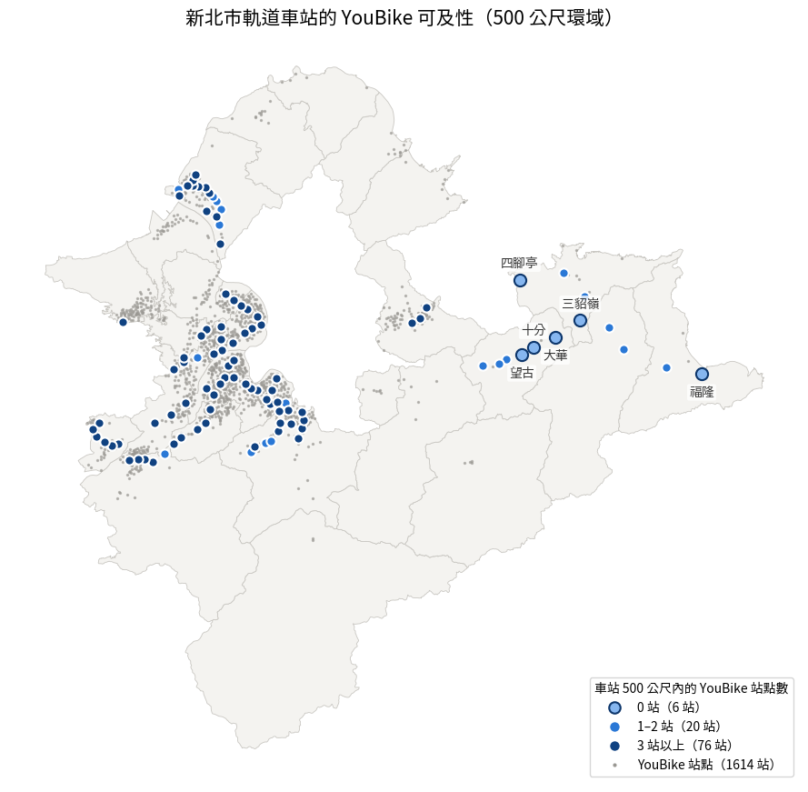
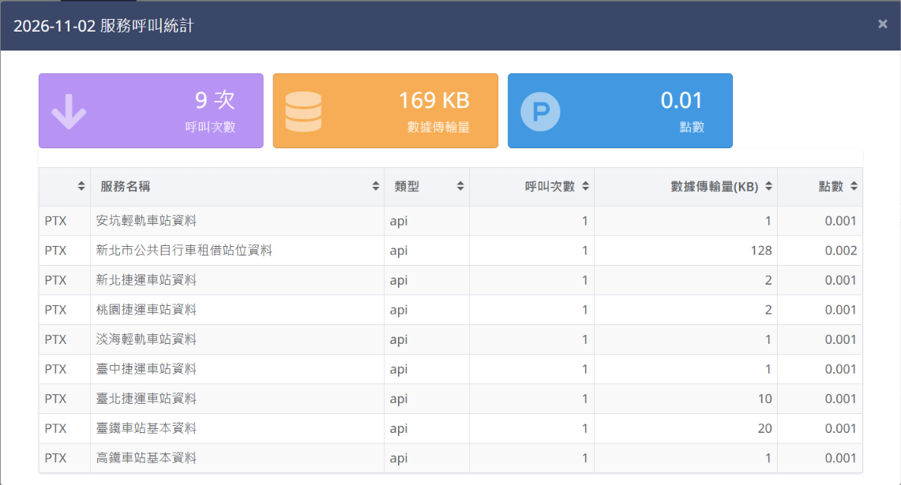

# HW7｜車站周邊的自行車可及性

| **項目** | **內容** |
| --- | --- |
| 學號 ／ 姓名 | S1254059 / 吳佳泰 |
| 週次 | 第七週 |
| 使用工具 | Claude Code CLI |
| 模型與權限模式 | manual |
| 成果連結 |  [Google Colab](https://drive.google.com/file/d/17rK1ZyCncXOpbyRw2px6KLjcQ0yxwXeG/view?usp=sharing) |
| 花費時間 | 約  6 小時 |

# 1. Before AI

**我原本的想法／預期：**

預期本次作業利用臺北市來進行實作，因為新北市具有火車、高鐵與捷運，同時也具有偏鄉地區，因此也可以做比較多的分析。本次的作業應該也會以自己改寫老師的程式碼或是改寫上週作業為主，AI 問答為輔，因此可能不會有太多的 AI 對話內容，另外本次程式作業也會和之前一樣，可供本機和 Google Colab 執行。

**我已經知道的：**

站點 API 的取得、GIS 的 buffer 和 sjoin 等觀念

**我不知道的是：**

詳見「本週引導題的回答」第四題。

**本週引導題的回答：**

1. 你認為車站周邊**多遠以內**的 YouBike，才算「方便轉乘」？理由是什麼？
    
    > 我自己能接受的範圍 500 公尺以內，通常從車站到 YouBike 間的交通方式是走路，因此距離不可太遠，否則大家可能就會選擇直接選擇直接從車站走路到目的地，省去尋找 YouBike 的時間。
    
2. 你猜你的縣市中，**哪些車站**周邊沒有 YouBike？先寫下站名，最後和結果比較。
    
    > 如果依照我的家鄉彰化縣來說，以火車站來說大概是二林站、永靖站、社頭站、源泉站等那些小站沒有 YouBike，但如果是以今天我要實作的新北市來說，我不知道新北實際有哪一些站點，因此也無法猜測，但就我知道的大站而言，例如板橋，應該都是有 YouBike 的。
    
3. 這份作業大概要呼叫 TDX API 幾次？**先寫下估算的次數**，最後和實際次數比較。
    
    > 1 次 (取得站點資料)
    
4. 我不知道的是……（至少寫 2 點）
    > * 如何在 Python 裡面使用 GIS 的技術，例如環域等
    > * 哪些車站周邊沒有 YouBike、新北市有哪一些車站

---

# 2. Ping-Pong Log

作業要求已刪除此區塊

---

# 3. 決策表

作業要求已刪除此區塊

---

# 4. 最終產出與個人結論

- 最終產出
    
    
    
- 個人結論
    
    本次的作業前半部份屬於自己實做，但後續因為期中考比較忙碌，還有其他的課頁，沒有太多的時間，因此我打破了 before AI 的宣告，後面的作業基本上請 Agent 來完成，並且最後由 Agent 檢查一遍，之後我在執行一遍確認狀態。
    
    作業成果基本上如我預期，有許多車站種類，而且有一些車站附近是沒有 YouBike 的，甚至 Agent 還很貼心的再圖片幫我把 500 公尺內沒有站點的車站特別醒目標示。因此如果我是新北市政府交通局，會優先對望古、十分、大華、三貂嶺、四角亭和福隆 6 個站底設置，不過我想是因為這些區域人口較稀少，或是較無需求，因此才沒有設置 YouBike 站點，我需要其他有關那些地區的人口相關資料與交通資料才能做進一步的推定。
    
    關於 token 的消耗，目前針對 11/02 的部分，程式和 TDX 網站紀錄相符，均為呼叫 10 次 API
    
    
    

---

# 5. 附件

* [07_rail_bike_對話紀錄.txt](../conversation/07_rail_bike_對話紀錄.txt)