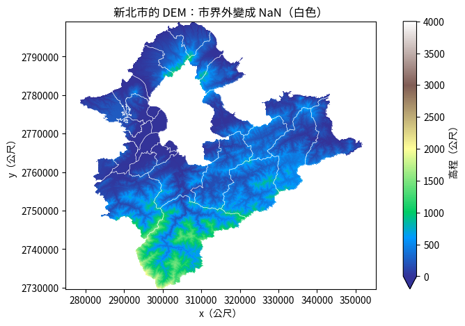
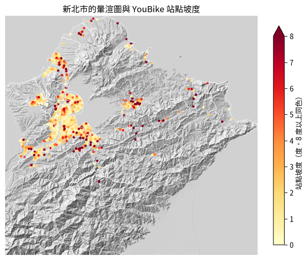
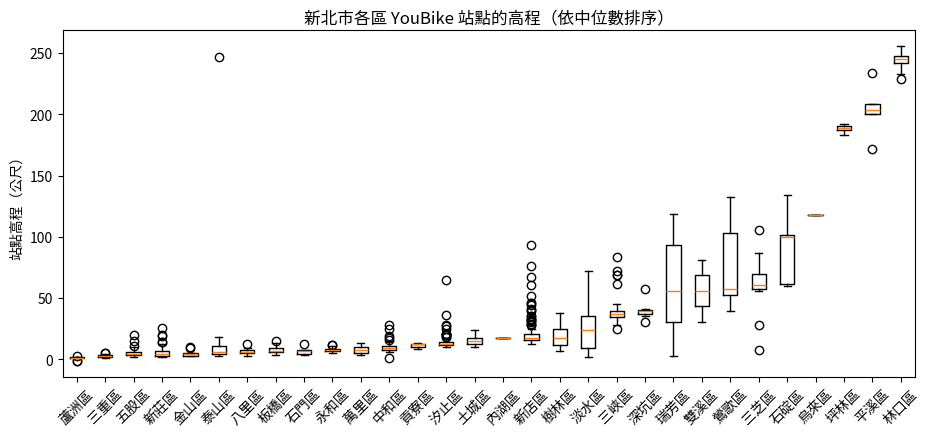
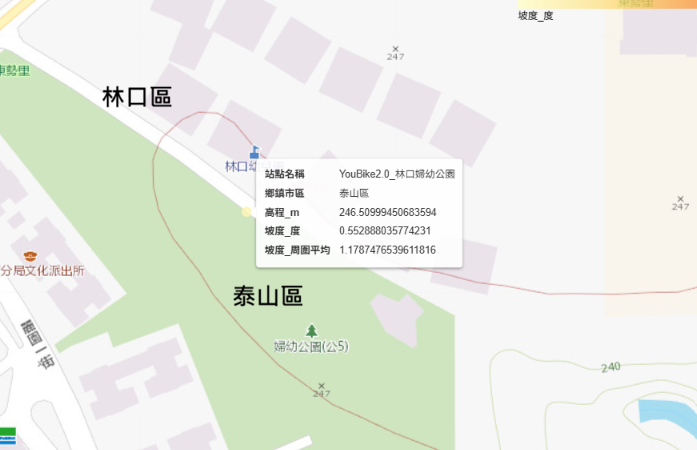

# HW9｜站點坡度與地形

| **項目** | **內容** |
| --- | --- |
| 學號 ／ 姓名 | S1254059 / 吳佳泰 |
| 週次 | 第九週 |
| 使用工具 | Claude Code CLI |
| 模型與權限模式 | manual |
| 成果連結 |  [Google Colab](https://drive.google.com/file/d/1woScLxjHP5631gQwxnoMMqhuvqCCGuBk/view?usp=sharing) |
| 花費時間 | 約  6 小時 |

# 1. Before AI

**我原本的想法／預期：**

> 預期會計算各縣市區域、各個公共自行車站點的坡度，並畫出相關的圖表與地圖。作業實做還是希望能以改寫老師的程式碼為主。

**我已經知道的：**

> 這次好像沒什麼知道的，都是新知識。

**我不知道的是：**

> 詳見「本週引導題的回答」第三題。

**本週引導題的回答：**

1. 你預期你的縣市中，哪些站點位在坡地？先寫下 2–3 個地點或站名，最後和
結果比較。這些站點的借還，你猜會有什麼特徵？
    
    > 如果是我所在的彰化縣，在坡地大概是彰化高商、彰化藝術高中、彰化師大師大校區等站點，如果是我作業選擇的新北市，坡地應該會位在烏來、三峽或坪林區的站點。這些站點的借還還需要看周圍設施，如果周圍是學校，那麼借還量應該比較不會受到影響。
    
2. 20 公尺解析度的 DEM，能不能反映一個 YouBike 站點旁邊的坡度？為什麼？
    
    > 可能有點太大，畢竟一個站點的位置很小，如果用 20 公尺的 DEM 可能會不夠準確，以上純屬猜測。
    
3. 我不知道的是……（至少寫 2 點）
    > * 本次作業對於坡度的詳細概念
    > * `rasterio`、 `xarray`、 `rioxarray` 函式的使用與功能
    > * 哪一些站點位在坡地
    > * GeoTIFF 的資料解讀

# 2. Ping-Pong Log

---

作業要求已刪除此區塊

---

# 3. 決策表

作業要求已刪除此區塊

---

# 4. 最終產出與個人結論

- 最終產出
    
    
    
    
    
    
    
    
    
    
- 個人結論
    
    本次作業大部分都是自己改寫老師的課堂示範程式碼，Agent 在這次作業扮演的角色是一些程式小問題 debug，以及一些知識上的詢問使用。程式在本地端實做，完成後上傳到雲端，並確認雲端與本地都是可以執行的。此外如果將程式碼的 `CITY` 更換成其他的縣市代碼也是可以執行並產出圖片的(只是某些地方的常識驗證需要更換一下地區)。  
    
    本次作業讓我發現了新北市裡的各站點坡度，也藉此讓我更認識了新北市的一些區域與地形，最後產出的盒鬚圖，橘線表示中位數，盒子上下緣表示 PR25 和 PR75 的位置，盒子高度表是分散的程度，鬚線表示延伸到盒子高度 1.5 倍以內最遠的站，而圓圈表示離群值。  
    
    我們可以發現大多數區的站點都在平地，中位數很低，盒子也很扁，但可以發現一些區域有特別的情況，像是林口區是高但是平坦；瑞芳區、鶯歌區、淡水區是盒子很高，代表高地落差大；新店區、汐止區、山峽區有很多往上的離群值，代表大部分的站點位在平地，但是有些站點可能是山坡上的社區。
    
    最特別的是，泰山區有一個明顯的離群值，經查證後發現此站是林口婦幼公園，以鄉鎮市區界做空間判斷後，站點位於泰山區境內但非常接近林口區(在 Google Map 上看是位在林口區)，利用圖表對照後發現這個點和林口區的中位數也很接近。這表示資料提供者標記的行政區，不一定等於依空間位置判斷的行政區。
    
    
    
    

---

# 5. 附件

* [09_station_terrain_對話紀錄.txt](../conversation/09_station_terrain_對話紀錄.txt)